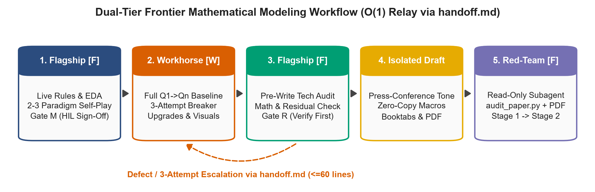

<div align="center">

# `math-modeling-frontier`

**面向新一代旗舰模型的极简双层数模竞赛工程 Skill**
*Zero Cognitive Shackles · Dual-Tier Relay · O(1) Cross-Model Memory · Nature/Science Visuals · Zero-Transcription LaTeX*

[](./LICENSE)
[](./.agents/skills/math-modeling-frontier/SKILL.md)
[_%E2%89%A460_Lines-D95F02.svg)](#2-o1-分层接力记忆跨模型切换不失忆不爆上下文)
[](#五-一键安装与跨平台复用)

</div>

---

## 为什么做这个 Skill？（给旗舰模型摘掉“辅助轮”）

市面上绝大多数高星数模 Skill，本质是在给上一代弱模型打补丁：动辄几千行保姆式 SOP、硬编码“评价题必用熵权法+TOPSIS”的套路表。把这套紧箍咒套在当代顶级推理模型上，**不仅白白吃掉上下文，还会把模型原生的数学直觉和创新上限反向锁死**。

而直接裸跑顶级模型打 72–99 小时数模竞赛，又必然踩中三个真实痛点：
1. **死磕单题卡死全局**：遇到非凸优化不收敛或病态求解器，反复修到第 8 遍把后面几问拖烂尾；
2. **通篇写满防御性废话**：模型脑补严苛评委，在摘要和结果段疯狂自我捅刀、堆砌免责声明、把试错日记写进正文；
3. **长程漂移与“手抄幻觉”**：切模型忘上下文、半夜改代码重跑后论文里残留旧数字、默认 Matplotlib 廉价丑图、匿名/查重低级失误。

**`math-modeling-frontier` 的核心哲学只有一句话：**
> **把 99% 的推理自由度还给旗舰模型，把“防卡死、防失忆、防编数、防写怂、大刊审美”全部压进 34 行极简协议 + 4 个确定性 Python 脚本。**

---

## 一、 架构全景与大刊级出图实拍

<p align="center">
  
</p>

> 上图直接由内置 [plot_style.py](./.agents/skills/math-modeling-frontier/scripts/plot_style.py) 的 `plot_pipeline_diagram()` 矢量渲染生成——零 AI 生图乱码，可直接作为论文 **Figure 1 整体技术路线图**。

<p align="center">
  
</p>

> 上图为 `python plot_style.py --self-test` 一键生成的 *Nature/Science* 双栏（`7.2 in`）三联图实拍：粗体 `a, b, c` 面板标识、无框图例、95% CI 置信带、灵敏度龙卷风图、零中心自动反色 `RdBu_r` 热力图，支持中英文一键切换。

---

## 二、 六大核心亮点

### 1. 旗舰思考 × 主力执行 × 旗舰审查（双层接力 + 写前总审 `Gate R`）
- **旗舰 `[F]` 零负载裸跑**：Step 1（选题/EDA/范式自博弈/定路线）与 Step 4（写前技术总审）**不加载任何额外参考文件**，只看 34 行 `SKILL.md`，彻底释放原厂高智商。
- **主力 `[W]` 高性价比落地**：按路线完成清洗、全题 Baseline、模型深化、科研出图与初稿。
- **传统数模铁序（先算通审过，再动笔写论文）**：在计算和写作之间硬插 **Step 4 旗舰写前总审（`Gate R`）**，确认数学自洽、物理/常识合理、残差无异常、证据链无缺口后才放行写作；有硬伤直接写返工单回 `[W]`，避免带着错数写完 25 页再返工。

### 2. O(1) 分层接力记忆：跨模型切换不失忆、不爆上下文
| 温度层 | 文件 | 读写规则 | 为什么永远不膨胀？ |
| :--- | :--- | :--- | :--- |
| **热层 (HOT)** | `handoff.md` | **每次切模型唯一必读文件** | **硬上限 ≤ 60 行，每次交接直接覆写（绝不追加）**，并由 `audit_paper.py --check-handoff` 强制校验行数、禁贴代码块与指针真实性——从第 1 小时到第 96 小时恒定 ~700 tokens！ |
| **基准层 (CANONICAL)** | `00_plan.md` | 按需读对应小节 | 存动态提取的最新赛制红线、`Q1→Qn` 数学主干、统一符号总表、实验举证表与门禁状态。 |
| **冷层 (COLD)** | `01_log.md` | **默认绝不加载**（只追加） | 存 EDA 统计细节、外部数据/引文出处、废弃路线与熔断档案，排错时才按需检索。 |
| **零拷贝指针** | `03_outputs/metrics/` & `figs/` | 仅传路径与一行指标 | 严禁把大表/代码粘进 Markdown 记忆，彻底杜绝上下文腐烂。 |

### 3. 防卡死双保险：全题 Baseline 优先 + 3-Attempt & 超时熔断
- **全局先贯通**：全题 `Q1 → Qn` 端到端 Baseline 跑通并落盘 `baseline.json`（过 `Gate P1`）之前，禁止在任何单问深挖高复杂度算法；通过门禁即 `git commit` 快照防改崩。
- **防死等 + 防死磕**：重求解先小规模 `N` 冒烟并设显式超时；同一瓶颈连续 **3 次根因修复失败**、超时或出现破坏假设的数据异常，**立即停机禁止第 4 次盲修**，通过 `handoff.md` 交回旗舰 `[F]` 按 `L1 精确解 → L2 机理保真近似（附间隙/残差界）→ L3 解析上下界/蒙特卡洛区间` 体面降级。

### 4. 数据 → 论文“零手抄”同步 + 过期硬拦截（0% 旧数幻觉）
- 内置 [sync_metrics.py](./.agents/skills/math-modeling-frontier/scripts/sync_metrics.py)：
  - 自动将 `03_outputs/metrics/*.json` 编译为 `04_paper/generated_metrics.tex` 数值宏（如 `\ValModelComparisonRmseProposed`），摘要/正文/图注直接引用宏，**半夜改代码重跑后全论文数字一键原子更新**；
  - 自动将 `03_outputs/metrics/*.csv` 编译为右对齐、自动加粗最优值、零竖线的 **Booktabs 标准三线表**（`\input{generated_tables/*.tex}`）。
- [audit_paper.py](./.agents/skills/math-modeling-frontier/scripts/audit_paper.py) 内置 **`[STALE_METRICS_TEX]` 新鲜度硬门禁**：一旦某次重跑更新了 `.json`/`.csv` 却忘了同步 `.tex`，终审直接 `FAIL` 拦截。

### 5. 大刊科研审美编入代码，1 行 `❌→✅` 精准校准不啰嗦
- **图表审美靠代码不靠嘴**：[plot_style.py](./.agents/skills/math-modeling-frontier/scripts/plot_style.py) 内置 *Nature / Science / PNAS* 单栏（`3.5 in`）、1.5 栏（`5.0 in`）、双栏（`7.2 in`）物理宽度、色盲/灰度安全低饱和色板 + 线型/标记双冗余、`label_panels()`、`plot_with_ci()`、`plot_tornado()`、`plot_diverging_heatmap()`、`plot_pipeline_diagram()`、`add_zoom_inset()` 及 `.pdf` + 300 DPI `.png` 双导出防遮挡自检；[visual.md](./.agents/skills/math-modeling-frontier/references/visual.md) 仅 **8 行**。
- **反防御与论文排版靠微对照**：写作（Step 5）与审稿（Step 6）**物理会话+文件双隔离**；[writing.md](./.agents/skills/math-modeling-frontier/references/writing.md) 仅 **20 行**，用 1 行 `❌→✅` 精准消灭 D1–D5 防御废话、试错日记、照搬题干和廉价竖线表，局限性统一收口到文末一节。

### 6. 独立两阶段红队终审 + PDF 逐页视觉核查
- Step 6 强制另开独立只读旗舰会话（**建议换用不同于写作模型的另一款旗舰模型交叉审稿**），先运行 [audit_paper.py](./.agents/skills/math-modeling-frontier/scripts/audit_paper.py)：
  - **Stage 1 硬门禁（不通过直接阻断 Stage 2）**：自动扫内部工程词泄漏、正文/代码（`02_src/`）/PDF 元数据匿名与本地路径泄漏、`\ref` 断链、`generated_metrics.tex` 过期、LaTeX 编译 `.log` 严重警告；同时用 `--render-pdf` 将 `main.pdf` **逐页转成 PNG** 供多模态旗舰“肉眼”审查每一页版面，配合 10 点数值溯源与 L3 引文忠实度审计。
  - **Stage 2 最小手术精修**：仅输出 `位置 | 类别 | 原句 | 建议替换` 手术表，绝不推倒重写健康段落。
- **动态赛制适配**：不硬编码过时赛制表，Step 0 直接读取你上传到 `00_problem/` 的最新官方要求文件，自动适配 APMCM、MCM/ICM、CUMCM、统计建模、泰迪杯等任意赛事；并保留距截止 `< 8h` 的 **Deadline Guard** 保底封卷模式。

---

## 三、 横向对比

| 维度 | 直接裸跑顶级模型 | 传统重型数模 Skill | `math-modeling-frontier` |
| :--- | :--- | :--- | :--- |
| **规则体量 / 智商约束** | 0 约束，但易跑偏成拼盘 | 数千行 SOP + 固定算法表，反向锁死上限 | **34 行核心主控 + 3 个超薄参考（共 49 行）**，旗舰思考期零参考负载 |
| **切模型记忆管理** | 聊天越长越蠢，切窗口失忆 | 堆大段历史日志，吃爆上下文 | **O(1) `handoff.md`（≤60 行硬校验）+ 冷热分离 + 零拷贝指针** |
| **遇到卡壳难题** | 死磕单题拖垮全队 | 死板卡死或胡编过关 | **全题 Baseline 先行 + 小规模限时 + 3-Attempt 熔断交回旗舰降级** |
| **数据与论文一致性** | 易混用旧实验数、手抄出错 | 靠口头提醒，仍易漂移 | **`sync_metrics.py` 自动宏与三线表 + `[STALE_METRICS_TEX]` 硬拦截** |
| **图表与写作气质** | 默认丑图 + 通篇防御性废话 | AI 套话连篇、廉价感强 | **Nature/Science 绘图代码库 + 写作/审稿物理隔离 + PDF 逐页渲染审** |

---

## 四、 仓库结构

```text
.
├── assets/                                              # README 实拍效果图（均由内置 plot_style.py 生成）
├── .agents/skills/math-modeling-frontier/
│   ├── SKILL.md                                         # [34行] 主控：双层角色、O(1) 接力、Step 0→6、6 条底线
│   ├── references/
│   │   ├── visual.md                                    # [8行]  仅 Step 3 加载：Nature/Science 视觉对照
│   │   ├── writing.md                                   # [20行] 仅 Step 5 加载：❌→✅ 反防御、三线表与论文审美
│   │   └── audit.md                                     # [21行] 仅 Step 6 加载：独立两阶段红队终审
│   └── scripts/
│       ├── init_project.py                              # 一键建目录、O(1) 三层记忆与 plot_style.py
│       ├── plot_style.py                                # Nature/Science/PNAS 矢量绘图与组图原语库
│       ├── sync_metrics.py                              # JSON/CSV → LaTeX 数值宏与 Booktabs 三线表零手抄同步
│       └── audit_paper.py                               # Stage 1+2 全自动扫描 + 过期检测 + handoff 校验 + PDF 转 PNG
├── LICENSE
└── README.md
```

---

## 五、 一键安装与跨平台复用

### 方式 1：Antigravity / Codex / Claude Code / Cursor 全局安装
```powershell
# Windows PowerShell（安装到 Antigravity 全局 skills 目录）
Copy-Item -Recurse -Force ".\.agents\skills\math-modeling-frontier" "$env:USERPROFILE\.gemini\config\skills\math-modeling-frontier"
```
```bash
# macOS / Linux（按需替换为 ~/.claude/skills/ 或 ~/.codex/skills/）
cp -r .agents/skills/math-modeling-frontier ~/.gemini/config/skills/math-modeling-frontier
```

### 方式 2：在单个比赛项目中使用
直接克隆或将 `.agents/skills/math-modeling-frontier/` 放入你的比赛工作区根目录，Agent 将自动发现并按需激活。

---

## 六、 开赛即用的 5 句双层切换口令

1. **`[W]` Step 0 → `[F]` Step 1（动态提规 + 旗舰满血定路线）**
   > 使用 `math-modeling-frontier`。本次比赛最新要求与赛题在 `00_problem/`，原始数据在 `01_data/raw/`。请完成 Step 0–1：运行 `init_project.py` 初始化目录并提取最新赛制规则写入 `00_plan.md`；完成选题评估、真实 EDA 与统计前提检验，自主提出 3 套异质范式自博弈攻防，定好 `Q1→Qn` 递进主干与全题 Baseline 路线，写好 ≤60 行的 `handoff.md` 后停在 **Gate M** 等我拍板。

2. **`[W]` Step 2 → 3（主力模型跑通 Baseline、深化验证、同步宏与大刊出图）**
   > 使用 `math-modeling-frontier`，你是主力执行模型 `[W]`。读 `handoff.md`（按需查 `00_plan.md`），先跑通全题清洗与 `Q1→Qn` Baseline 过 **Gate P1**（仅用相对路径；重求解先小规模冒烟加超时；触发 3-Attempt 熔断或假设异常立刻写回 `handoff.md` 交 `[F]`）。通过后加载 `references/visual.md` 完成对比、消融、95% CI、±5%–±10% 灵敏度，运行 `sync_metrics.py` 同步数值宏与三线表，用 `plot_style.py` 导出全套高清图并逐张目检 PNG 过 **Gate P2**，校验 `handoff.md` 后交 `[F]` 审查。

3. **`[F]` Step 4（旗舰写前技术总审 `Gate R` — 确认没问题再写论文）**
   > 使用 `math-modeling-frontier`，你是旗舰审查模型 `[F]`。读 `handoff.md`、`00_plan.md`、`03_outputs/metrics/` 与 `figs/` 执行 **Step 4（Gate R）**：严查数学自洽性、物理/经济常识、残差矛盾、统计前提与证据完整度。有硬伤直接把返工单覆写进 `handoff.md` 退回 `[W]`；全部确认没问题再放行写作。

4. **`[W]` 或 `[F]` Step 5（新开干净窗口隔离写作）**
   > 使用 `math-modeling-frontier` 进入 **Step 5（W-Draft）**，仅加载 `references/writing.md`（严禁加载 `audit.md`）。读 `handoff.md`、`00_plan.md`、`generated_metrics.tex`、`generated_tables/` 与 `figs/`，按新闻发布会原则、原创防查重与大刊三线表规范撰写正文，最后精雕量化摘要并编译 PDF。

5. **`[F]` Step 6（另开独立只读旗舰窗口终审，建议换不同旗舰模型）**
   > 加载 `references/audit.md` 执行 **Step 6（W-Audit）**。先运行 `scripts/audit_paper.py`（传入 `--metrics-dir`、`--figs-dir`、`--src-dir 02_src`、`--log`、`--pdf`、`--render-pdf 03_outputs/_audit_pages`），完成 Stage 1 硬门禁与逐页 PNG 视觉审查全绿后，再输出 Stage 2 最小手术修订表。

---

## 许可协议

本项目基于 [MIT License](./LICENSE) 开源。欢迎根据你的竞赛工作流按需裁剪，让顶级模型专注思考，让确定性代码守住底线。
