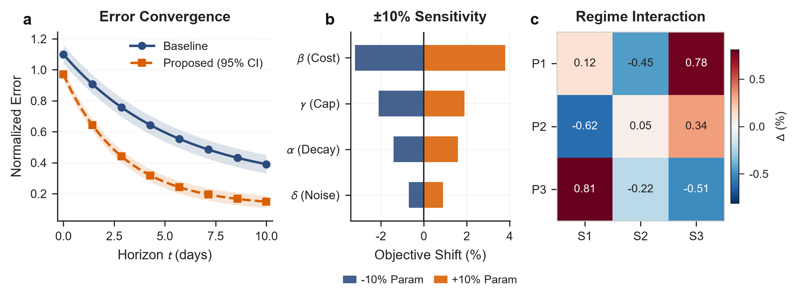

<div align="center">

# `math-modeling-frontier`

**面向新一代旗舰模型的极简双层数模竞赛工程 Skill（v1.5）**
*Zero Cognitive Shackles · Dual-Tier Relay · O(1) Cross-Model Memory · Nature/Science Visuals · Zero-Transcription LaTeX*

[](https://github.com/monesy231/math-modeling-frontier/actions/workflows/ci.yml)
[](./LICENSE)
[](./.agents/skills/math-modeling-frontier/SKILL.md)
[_%E2%89%A480_Lines-D95F02.svg)](#2-o1-分层接力记忆跨模型切换不失忆不爆上下文)
[](#五-一键安装与本地自测)

</div>

---

## 为什么做这个 Skill？（给旗舰模型摘掉“辅助轮”）

市面上绝大多数高星数模 Skill，本质是在给上一代弱模型打补丁：动辄几千行保姆式 SOP、硬编码“评价题必用熵权法+TOPSIS”的套路表。把这套紧箍咒套在当代顶级推理模型上，**不仅白白吃掉上下文，还会把模型原生的数学直觉和创新上限反向锁死**。

而直接裸跑顶级模型打 72–99 小时数模竞赛，又必然踩中三个真实痛点：
1. **死磕单题卡死全局**：遇到非凸优化不收敛或病态求解器，反复修到第 8 遍把后面几问拖烂尾；
2. **通篇写满防御性废话**：模型脑补严苛评委，在摘要和结果段疯狂自我捅刀、堆砌免责声明、把试错日记写进正文；
3. **长程漂移与“手抄幻觉”**：切模型忘上下文、半夜改代码重跑后论文里残留旧数字、默认 Matplotlib 廉价丑图、匿名/查重低级失误。

**`math-modeling-frontier` 的核心哲学只有一句话：**
> **把 99% 的推理自由度还给旗舰模型，把“防卡死、防失忆、防编数、防写怂、大刊审美”全部压进 44 行极简协议 + 4 个有完整 E2E 测试与 CI 保障的确定性 Python 脚本。**

---

## 一、 架构全景与大刊级出图实拍

<p align="center">
  
</p>

> 上图直接由内置 [plot_style.py](./.agents/skills/math-modeling-frontier/scripts/plot_style.py) 的 `plot_pipeline_diagram()` 矢量渲染生成——零 AI 生图乱码，可直接作为论文 **Figure 1 整体技术路线图**。

<p align="center">
  
</p>

> 上图为 `python plot_style.py --self-test` 一键生成的 *Nature/Science* 双栏（`7.2 in`）三联图实拍：粗体 `a, b, c` 面板标识、无框图例、95% CI 置信带、灵敏度龙卷风图、零中心自动反色 `RdBu_r` 热力图，支持中英文一键切换。

---

## 二、 六大核心亮点

### 1. 旗舰思考 × 主力执行 × 旗舰审查（零负担 `MM Step 1–6` 一行切换 + `Gate R` 写前总审）
- **旗舰 `[F]` 零负载裸跑**：`MM Step 1`（选题/EDA/范式自博弈/定路线）与 `MM Step 4`（写前技术总审）**不加载任何额外参考文件**，只看 44 行 `SKILL.md`，彻底释放原厂高智商。
- **一行口令切模型（v1.1）**：告别来回粘贴上百字长提示词——每个步骤结束后，下一棒的一行短指令（如 `MM Step 2`）直接自动印在 `handoff.md` 末尾，切会话粘贴 10 个字即可精准接力，零贴错风险。
- **传统数模铁序（先算通审过，再动笔写论文）**：在计算和写作之间硬插 **Step 4 旗舰写前总审（`Gate R`）**，确认数学自洽、物理/常识合理、残差无异常、证据链无缺口后才放行写作；有硬伤直接写返工单回 `[W]`，避免带着错数写完 25 页再返工。

### 2. O(1) 分层接力记忆：跨模型切换不失忆、不爆上下文
| 温度层 | 文件 | 读写规则 | 为什么永远不膨胀？ |
| :--- | :--- | :--- | :--- |
| **热层 (HOT)** | `handoff.md` | **每次切模型唯一必读文件** | **默认硬上限 ≤ 80 行（支持 `--max-lines` 按题量调节），每次交接直接覆写（绝不追加）**，并由 `audit_paper.py --check-handoff` 强制校验行数、禁贴代码块与指针真实性——从第 1 小时到第 96 小时恒定 ~900 tokens！ |
| **基准层 (CANONICAL)** | `00_plan.md` | 按需读对应小节 | 存动态提取的最新赛制红线（`--plan 00_plan.md` 硬拦截任何未清除的 `[EXTRACT FROM 00_problem/]` / `[待核验]` 项）、`Q1→Qn` 数学主干、统一符号总表、实验举证表与门禁状态。 |
| **冷层 (COLD)** | `01_log.md` | **默认绝不加载**（只追加） | 存 EDA 统计细节、外部数据/引文出处、废弃路线与熔断档案，排错时才按需检索。 |
| **零拷贝指针** | `03_outputs/metrics/` & `figs/` | 仅传路径与一行指标 | 严禁把大表/代码粘进 Markdown 记忆，彻底杜绝上下文腐烂。 |

### 3. 防卡死双保险：全题 Baseline 优先 + 3-Attempt & 超时熔断
- **全局先贯通**：全题 `Q1 → Qn` 端到端 Baseline 跑通并落盘 `baseline.json`（过 `Gate P1`）之前，禁止在任何单问深挖高复杂度算法；通过门禁即 `git commit` 快照防改崩。
- **防死等 + 防死磕**：重求解先小规模 `N` 冒烟并设显式超时；同一瓶颈连续 **3 次根因修复失败**、超时或出现破坏假设的数据异常，**立即停机禁止第 4 次盲修**，通过 `handoff.md` 交回旗舰 `[F]` 按 `L1 精确解 → L2 机理保真近似（附间隙/残差界）→ L3 解析上下界/蒙特卡洛区间` 体面降级。

### 4. 数据 → 论文“零手抄”同步 + 过期与孤儿表硬拦截（0% 旧数/幽灵表幻觉）
- 内置 [sync_metrics.py](./.agents/skills/math-modeling-frontier/scripts/sync_metrics.py)：
  - 自动将 `03_outputs/metrics/*.json` 编译为盲审洁净的 `04_paper/generated_metrics.tex` 数值宏（自动拒绝 `NaN/Inf`、**中文字段稳定生成唯一 ASCII 宏名、任何重名碰撞直接报错中止并列出双方原始键名**、自动格式化 95% CI 区间），**半夜改代码重跑后全论文数字一键原子更新**；
  - 自动将 `03_outputs/metrics/*.csv` 编译为右对齐、自动加粗最优值、零竖线的 **Booktabs 标准三线表**（`\input{generated_tables/*.tex}`），同步记录 `_sync_manifest.json` 溯源清单并**自动清理已撤回实验的孤儿旧表**。
- [audit_paper.py](./.agents/skills/math-modeling-frontier/scripts/audit_paper.py) 内置 **`[STALE_METRICS_TEX]` + `[ORPHAN_GENERATED_TABLE]` + `[MISSING_TABLE_SOURCE]` 三重硬门禁**：改代码忘同步或撤回 CSV 后正文仍引用旧表，终审直接 `FAIL` 拦截。

### 5. 大刊科研审美编入代码，1 行 `❌→✅` 精准校准不啰嗦
- **图表审美靠代码不靠嘴**：[plot_style.py](./.agents/skills/math-modeling-frontier/scripts/plot_style.py) 内置 *Nature / Science / PNAS* 单栏（`3.5 in`）、1.5 栏（`5.0 in`）、双栏（`7.2 in`）物理宽度、色盲/灰度安全低饱和色板 + 线型/标记双冗余、`label_panels()`、`plot_with_ci()`、`plot_tornado()`、`plot_diverging_heatmap()`、`plot_pipeline_diagram()`、`add_zoom_inset()`、`group_close_points()` 及 `.pdf` + 300 DPI `.png` 双导出防遮挡自检；[visual.md](./.agents/skills/math-modeling-frontier/references/visual.md) 仅 **11 行**。
- **反防御与论文排版靠微对照**：写作（Step 5）与审稿（Step 6）**物理会话+文件双隔离**；[writing.md](./.agents/skills/math-modeling-frontier/references/writing.md) 仅 **28 行**，用 1 行 `❌→✅` 精准消灭 D1–D5 防御废话、试错日记、照搬题干和廉价竖线表，局限性统一收口到文末一节。

### 6. 原始数据防篡改封条 + 交付物 CSV 审计 + 独立两阶段红队终审 + 真 LaTeX 编译 CI 保障
- **原始数据只读与 SHA-256 防篡改封条（v1.3）**：`00_problem/` 与 `01_data/raw/` 严格只读（所有清洗与派生数据一律写入 `01_data/clean/`）；`init_project.py --lock-raw` 自动生成 `01_data/.raw_checksums.json` 校验封条，`audit_paper.py --verify-raw` 同时做 **SHA-256 逐文件完整性校验**（篡改/删除原文件直接 `FAIL`）与 **`02_src/` 静态写拦截**（拦截任何脚本往 `01_data/raw/` 覆盖写或删文件）。
- **实战淬炼的交付物 CSV、反例探针与配套文档核验体系（v1.4）**：
  - 在 Step 2/3/4 引入**独立于求解器的结果核验器**（`verify.py`，要求使用 `zip_longest` 全长比对并拦截静默截断型 `zip()`）、**负向篡改探针**（覆盖硬约束违约、提交文件末尾多行、指标表替换与文件缺失）、**2 元素同属性边界反例与分等级容量帽核查**、**开放可行域松弛上下界自洽**、**单因素（ceteris paribus）消融与反事实关闭净增益**，以及**块自助法 vs. 蒙特卡洛扰动区间溯源**；
  - `audit_paper.py --check-csv`（及 `--strict-csv`）自动审计提交 CSV（拦截 `UTF-8 BOM`、`NaN/Inf`、错列、完全重复行以及未合并的重复复合主键/拆分决策变量行）；
  - 自动发现并同源审计根目录官方配套文档（`作品说明单*.md`、`AI协作记录*.md`），硬拦截**未删除的官方模板填写提示**（`[TEMPLATE_INSTRUCTION_LEAK]`）、**超过 60 字的一句话概述**（`[SUMMARY_OVER_60_CHARS]`）、**自相矛盾的同值变化笔误**（如 `"由 2,586 票降至 2,586"`，`[DEGENERATE_CHANGE]`）以及**正文/说明单声称页数与实际编译 PDF 页数不符**（`[PDF_PAGE_COUNT_MISMATCH]`），并对提交前待填报的报名队名/人数发出显式提醒（`[REGISTRATION_PLACEHOLDER]`）。
- **多轮红队终审沉淀的硬页限、可回放证据链与工程便携性门禁（v1.5）**：
  - `audit_paper.py` 新增 **`--max-pages` / `00_plan.md` Sec. 0 硬页限自动拦截**（`[PDF_OVER_PAGE_LIMIT]`）、**赛中新增官方文件未封存硬拦截**（`--verify-raw` 下 `[RAW_UNSEALED_FILE]` 升级为 `FAIL`）、**正文路径引用附图智能豁免**（识别正文中直接引用的补充图表路径，消除 `[UNUSED_FIG]` 误报）、**`04_paper/*.py` 构建脚本跨平台字体回退告警**（`[SRC_OS_FONT_HARDCODE]`）与 **`--check-html` 离线交互看板审计**（拦截本地路径/内部词泄漏、外链 CDN 依赖及 `node --check` JS 语法报错）；`plot_style.py` 新增 `group_close_points()` 在最终印刷尺寸下聚类拥挤散点；
  - 在 Step 3–6 固化**双向边界反例与定案状态缓存同步校验**（涵盖触发边界 `± ε` 与末单定案/同伴留存双场景）、**事后参数不变性测试**、**双口径官方指标与严格字典序同表披露**、**前推时序锁参验证（`E5`）**、**可回放结构化诊断证据链**（篡改替换合法策略文案仍必报错）以及**冷启动清缓存逐字节复现**。
- Step 6 强制另开独立只读旗舰会话（**建议换用不同于写作模型的另一款旗舰模型交叉审稿**），先运行 [audit_paper.py](./.agents/skills/math-modeling-frontier/scripts/audit_paper.py)：
  - **Stage 1 硬门禁（缺件或渲染失败一律 `FAIL`，绝不静默返回 0）**：按 6 项必填字段逐项核验 `00_plan.md` 赛规与来源、内部工程词与模板提示零泄漏、正文/代码（`02_src/`）/PDF 元数据零匿名与路径泄漏、PDF 提取文本零缺字乱码（`\ufffd`）与未渲染 LaTeX 源码残留、自称页数与 PDF 实际页数一致、`\ref` 无断链、无过期宏与孤儿表、指定的 `.pdf`/`.log`/目录必须真实存在且 `--render-pdf` 必须成功将 PDF **逐页转成 PNG**（自动注入 `.gitignore` 防止预览图污染仓库）供多模态旗舰“肉眼”审查每一页版面。
  - **Stage 2 章节感知信号 + 最小手术精修**：自动识别 LaTeX/Markdown 章节标题与代码环境——**在文末 *Strengths, Weaknesses / Limitations / AI Report* 章节和代码附录中自动豁免 `D2/D5` 误报**，只在摘要/引言/建模/结果/结论里严抓防御性废话与 AI 腔，仅输出 `位置 | 类别 | 原句 | 建议替换` 手术表。
- **真实交卷级 CI（Ubuntu 实编 `pdflatex` + Windows 跨平台矩阵）**：[tests/test_e2e_pipeline.py](./tests/test_e2e_pipeline.py) 不仅测试所有脚本正反路径，更在 Linux CI 中**实际调用 `pdflatex` 编译含中英文宏、三线表与 *Nature* 图件的 `main.tex → main.pdf`**，对同一次编译出的 `main.pdf` + `main.log` 跑通完整终审并渲染 PNG，随后删除 `main.pdf` 验证终审必然 `FAIL`。

---

## 三、 横向对比

| 维度 | 直接裸跑顶级模型 | 传统重型数模 Skill | `math-modeling-frontier` |
| :--- | :--- | :--- | :--- |
| **规则体量 / 智商约束** | 0 约束，但易跑偏成拼盘 | 数千行 SOP + 固定算法表，反向锁死上限 | **44 行核心主控 + 3 个超薄参考（共 68 行）**，旗舰思考期零参考负载 |
| **切模型记忆与操作负担** | 聊天越长越蠢，切窗口失忆 | 堆大段历史日志，吃爆上下文 | **O(1) `handoff.md`（≤80 行可配 + 硬校验）+ `MM Step 1–6` 一行切换** |
| **遇到卡壳难题** | 死磕单题拖垮全队 | 死板卡死或胡编过关 | **全题 Baseline 先行 + 小规模限时 + 3-Attempt 熔断交回旗舰降级** |
| **数据与论文一致性** | 易混用旧实验数、手抄出错 | 靠口头提醒，仍易漂移 | **`sync_metrics.py` 自动宏与三线表 + `[STALE_METRICS_TEX]` 硬拦截** |
| **图表、写作与测试保障** | 默认丑图 + 通篇防御性废话 | 无测试无 CI，正则易误报 | **Nature 绘图代码库 + 章节感知终审 + PDF 逐页渲染 + 跨平台 CI** |

---

## 四、 仓库结构

```text
.
├── .github/workflows/ci.yml                             # GitHub Actions 跨平台 CI（Ubuntu + Windows, Py3.11/3.12）
├── tests/test_e2e_pipeline.py                           # 全链路自动化测试（覆盖 4 脚本正反用例与端到端闭环）
├── assets/                                              # README 实拍效果图（均由内置 plot_style.py 生成）
├── .agents/skills/math-modeling-frontier/
│   ├── SKILL.md                                         # [44行] 主控：双层角色、O(1) 接力、MM Step 1–6、6 条底线
│   ├── references/
│   │   ├── visual.md                                    # [11行] 仅 Step 3 加载：Nature/Science 视觉对照与印刷可读性
│   │   ├── writing.md                                   # [28行] 仅 Step 5 加载：❌→✅ 反防御、硬页限、代码与正文一致性
│   │   └── audit.md                                     # [29行] 仅 Step 6 加载：独立两阶段红队终审
│   └── scripts/
│       ├── init_project.py                              # 一键建目录、O(1) 三层记忆（≤80行）、raw 封条与 plot_style.py
│       ├── plot_style.py                                # Nature/Science/PNAS 矢量绘图、group_close_points() 与组图原语库
│       ├── sync_metrics.py                              # JSON/CSV → LaTeX 数值宏与 Booktabs 三线表零手抄同步
│       └── audit_paper.py                               # Stage 1/2 终审 + 硬页限/赛制/handoff/CSV/HTML/字体/附图/PDF 转 PNG
├── LICENSE
└── README.md
```

---

## 五、 一键安装与本地自测

### 安装到全局（Antigravity / Codex / Claude Code / Cursor）
```powershell
# Windows PowerShell（Antigravity 全局 skills 目录）
Copy-Item -Recurse -Force ".\.agents\skills\math-modeling-frontier" "$env:USERPROFILE\.gemini\config\skills\math-modeling-frontier"
```
```bash
# macOS / Linux（按需替换为 ~/.claude/skills/ 或 ~/.codex/skills/）
cp -r .agents/skills/math-modeling-frontier ~/.gemini/config/skills/math-modeling-frontier
```

### 运行全链路自测（确认本机可用）
```bash
python -m unittest discover -s tests -v
```

---

## 六、 开赛即用的 1 行极简切换口令（告别粘贴长提示词）

把本次比赛最新要求文件和原始数据放进 `00_problem/` 与 `01_data/raw/` 后，每切换一个会话只需粘贴 **1 行**（`handoff.md` 末尾也会自动给出下一棒口令）：

| 步骤 | 推荐模型 | 1 行启动口令（直接复制） | 自动行为与门禁 |
| :--- | :--- | :--- | :--- |
| **Step 0→1** | `[F]` 旗舰 | `使用 math-modeling-frontier 执行 MM Step 1（先初始化并从 00_problem/ 提取最新规则）` | 提规、选题、EDA、3 范式自博弈 → 停在 **Gate M** 等拍板 |
| **Step 2** | `[W]` 主力 | `使用 math-modeling-frontier 执行 MM Step 2` | 读 `handoff.md` → 清洗与全题 Baseline → 校验规则与接力包过 **Gate P1** |
| **Step 3** | `[W]` 主力 | `使用 math-modeling-frontier 执行 MM Step 3` | 加载 `visual.md` → 深化对比/灵敏度 + `sync_metrics.py` + 大刊终图过 **Gate P2** |
| **Step 4** | `[F]` 旗舰 | `使用 math-modeling-frontier 执行 MM Step 4` | 零参考负载技术总审 → 查数学/常识/残差 → 过 **Gate R** 才放行写作 |
| **Step 5** | `[W]`/`[F]` | `使用 math-modeling-frontier 执行 MM Step 5` *(新开干净窗口)* | 仅加载 `writing.md`（物理隔离审稿）→ 新闻发布会写法 + 宏引用 + 编译 PDF |
| **Step 6** | `[F]` 旗舰 | `使用 math-modeling-frontier 执行 MM Step 6` *(另开只读窗口/换另一旗舰)* | 仅加载 `audit.md` → 跑 `audit_paper.py`（含逐页转 PNG）→ Stage 1→2 最小手术 |

---

## 许可协议

本项目基于 [MIT License](./LICENSE) 开源。
